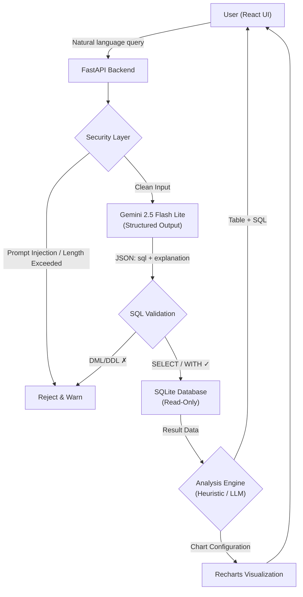

# PRD: Text-to-SQL Query Generator v2.0

> A professional, secure, and analytics-capable natural language → SQL query engine.

---

## 1. Problem Statement

The current Text-to-SQL application exists only as a basic prototype: user natural language input is executed against the database unfiltered without validation, data analysis/visualization capabilities are non-existent, and the HuggingFace `smolagents` model architecture is both slow and unconfigurable. **Users cannot safely query arbitrary databases using natural language, nor can they explore or visualize their data with meaningful charts.**

---

## 2. Why Now

| Problem | Impact |
|---|---|
| **Zero security layer** — `sql_tool` executes destructive queries (`DELETE`, `DROP TABLE`, `ALTER`) unfiltered | The entire database can be wiped with a single prompt |
| **No prompt injection protection** — User input goes directly to the LLM | Malicious actors can manipulate system instructions |
| **HuggingFace model is slow and costly** — Uses `smolagents` with `HfApiModel`, re-instantiating `CodeAgent` per request | Every query takes 10–30 seconds |
| **Zero analytical capabilities** — Only raw tabular data is returned | Users cannot derive actionable visual insights |
| **Single table, hardcoded schema** — Only the `employees` table is supported | Unsuitable for real-world applications |

---

## 3. Target Users

- **Primary**: Data analysts, business users, and students with little to no SQL expertise.
- **Secondary**: Developers who know SQL but need rapid prototyping and exploratory querying.

---

## 4. Success Criteria

| Metric | Target |
|---|---|
| Query response latency (p95) | < 5 seconds |
| Destructive query execution rate | 0% (strictly blocked) |
| Prompt injection success rate | 0% |
| Chart generation capability | 80% of eligible query results can be visualized |
| Supported table count | Dynamic — all tables in any connected database |

---

## 5. Solution Architecture (High Level)



---

## 6. Feature Specifications

### 6.1 — Model Migration: Gemini 2.5 Flash Lite (Structured Output)

> [!IMPORTANT]
> The HuggingFace `smolagents` stack is completely removed and replaced with Google **Gemini 2.5 Flash Lite** via the official `google-genai` SDK. A **structured output** approach is adopted rather than function calling.

**Why Structured Output?**
- Text-to-SQL is a single-purpose pipeline: the model only needs to return SQL + an explanation.
- Function calling adds unnecessary complexity with no multi-tool orchestration needed.
- Structured output is deterministic, straightforward to parse, and has a lower error rate.
- Detailed rationale: [ADR-0001](docs/adr/0001-gemini-structured-output.md)

**Structured Output Schema:**
```json
{
  "sql": "SELECT first_name, last_name FROM employees WHERE salary > 50000",
  "explanation": "Lists the first and last names of employees with a salary greater than 50,000."
}
```

**Implementation Steps:**
- Remove `smolagents`, `huggingface-hub`, and `duckduckgo-search` dependencies.
- Add `google-genai` package.
- Configure model settings in `.env`:
  ```env
  GOOGLE_API_KEY=your_gemini_api_key
  MODEL_NAME=gemini-2.5-flash-lite
  ```
- Dynamic model selection via `MODEL_NAME` environment variable.
- Initialize the model client once at application startup (singleton pattern).
- Mirror the query's natural language in the explanation.

**Current vs Target:**
| Current | Target |
|---|---|
| `smolagents.HfApiModel()` | `google.genai.Client()` |
| `HF_TOKEN` env variable | `GOOGLE_API_KEY` + `MODEL_NAME` env variables |
| `CodeAgent` re-created on each request | Single client instance across application lifecycle |
| Hardcoded model | Dynamic model selection from `.env` |
| Function calling / CodeAgent | Structured output — guaranteed JSON schema |

---

### 6.2 — Security Layer

> [!CAUTION]
> The legacy system had zero security controls. `sql_tool` could execute destructive queries directly.

#### 6.2.1 — SQL Query Validation

**Whitelist Approach** — Only allowed query types are executed:

```python
ALLOWED_SQL_PREFIXES = ["SELECT", "WITH"]  # WITH -> CTE (Common Table Expression) support
BLOCKED_KEYWORDS = [
    "DROP", "DELETE", "TRUNCATE", "ALTER", "CREATE", 
    "INSERT", "UPDATE", "REPLACE", "GRANT", "REVOKE",
    "EXEC", "EXECUTE", "MERGE", "CALL",
    "ATTACH", "DETACH", "PRAGMA",  # SQLite-specific risks
]
```

**Multi-Layered Validation:**
1. **Pre-execution Check:** Parse SQL generated by the LLM using `sqlparse` for AST analysis.
2. **Keyword Filter:** Reject queries containing any keywords in `BLOCKED_KEYWORDS`.
3. **Read-only Connection:** Open database connection in read-only mode (`sqlite3` URI: `file:sql_app.db?mode=ro`).
4. **Row Cap:** Automatically append `LIMIT 1000` when no explicit limit is specified.

#### 6.2.2 — Prompt Injection Defense

1. **Input Sanitization:**
   - Limit user input to a maximum of **1,000 characters**.
   - Strip control characters and sanitize suspicious patterns.
2. **System Prompt Armoring:**
   - Clear system instructions restricting generation strictly to SQLite `SELECT`/`WITH` statements.
   - Distinct roles: system instructions separated from user prompt.
3. **Output Validation:**
   - Verify structured JSON schema compliance.
   - Disallow multi-statement queries separated by semicolons.
4. **Rate Limiting:**
   - Enforce a global rate limit of **30 requests per minute**.

---

### 6.3 — Data Analysis and Visualization

> [!NOTE]
> **Hybrid Approach:** Automatic analysis mode applies heuristic rules with zero LLM latency and zero API cost. When custom natural language chart requests are made, the LLM is invoked.

#### 6.3.1 — Automatic Analysis Mode (Heuristic)

| Condition | Recommended Chart |
|---|---|
| Single numeric aggregate (COUNT, AVG, SUM) | Stat card |
| 1 categorical + 1 numeric column | Bar chart or Pie chart |
| Date/time + numeric column | Line chart |
| 2 numeric columns | Scatter plot |
| Categorical columns only | Table (no chart recommendation) |
| High cardinality (>20 rows) + categorical + numeric | Grouped bar chart |

#### 6.3.2 — Natural Language Visualization Commands (LLM Guided)

When custom visualizations are requested, the LLM determines the optimal chart configuration and returns concise Insights:

```
POST /analyze
{
  "query_result": [...],
  "columns": [...],
  "user_request": "Show salary distribution by department",
  "use_llm": true
}
```

#### 6.3.3 — Frontend Visualizations

- **Recharts** integration (Bar, Line, Pie, Scatter, Area, Stat Cards).
- Fluid toggle between table view and chart view.
- PNG chart export.
- Client-side CSV and JSON data export via Blob API.
- Collapsible Generated SQL panel with syntax highlight and copy button.

---

### 6.4 — Dynamic Schema Discovery

> [!TIP]
> The schema is dynamically discovered from `sqlite_master` at startup or on `/refresh-schema`, allowing database swaps by simply modifying `DATABASE_URL`.
> Detailed rationale: [ADR-0002](docs/adr/0002-dynamic-schema-without-orm.md)

- Extracted as full `CREATE TABLE` DDL declarations and injected directly into the system prompt.
- No static ORM models (`models.py` removed).
- Schema Explorer UI sidebar for interactive browsing.

---

### 6.5 — UI / UX Enhancements

| Feature | Description |
|---|---|
| **Query History** | Stores last 50 queries in `localStorage` with one-click re-execution |
| **Schema Explorer** | Left sidebar displaying tables and column structures |
| **Generated SQL Preview** | Expandable panel (expanded by default) with copy functionality |
| **Example Queries** | Clickable sample query pills for quick onboarding |
| **Dark Mode** | Theme toggle preserved across all components |
| **Error Handling** | Inline banners for query/validation errors; Sonner toasts for network/system errors |
| **Loading States** | Skeleton loaders and progress indicators |
| **Export Utilities** | Client-side CSV and JSON downloads |

---

## 7. Non-Goals (Out of Scope for v2)

| Feature | Reason Out of Scope |
|---|---|
| User authentication / RBAC | Focused on single-user local/portfolio usage |
| External DB engines (PostgreSQL, MySQL) | Deferred to v3; SQLite-first |
| DML / write operations (INSERT/UPDATE/DELETE) | Deliberately out of scope for safety |
| Real-time collaborative sessions | Single-user architecture |
| Native mobile applications | Web-first responsive UI |
| Schema token summarization | Deferred to v3 for enterprise databases |
| E2E browser automation test suite | Deferred to v3; backend unit & integration tests prioritized |

---

## 8. Technical Architecture

### 8.1 — Backend Structure

```
api/
├── main.py                 # FastAPI app, routes, lifespan
├── config.py               # Environment configuration (pydantic-settings)
├── database.py             # Read-only SQLAlchemy engine, raw execution, limit injection
├── schemas.py              # Pydantic request & response schemas
├── gemini_service.py       # Gemini API client (singleton, structured output)
├── tests/
│   ├── __init__.py
│   ├── test_database.py    # Database execution & read-only tests
│   └── test_query_api.py   # API integration tests
├── requirements.txt
└── Dockerfile
```

### 8.2 — Frontend Structure

```
src/
├── components/
│   ├── QueryInput.tsx
│   ├── ResultTable.tsx
│   ├── ChartView.tsx
│   ├── SqlPreview.tsx
│   ├── SchemaExplorer.tsx
│   └── QueryHistory.tsx
├── App.tsx
├── main.tsx
├── index.css
└── Dockerfile
```

---

## 9. Risk and Mitigation

| Risk | Likelihood | Impact | Mitigation |
|---|---|---|---|
| Gemini API rate limiting | Medium | Medium | Exponential backoff and descriptive user error toast |
| Model generates invalid SQL | High | Low | Read-only database + SELECT/WITH whitelist = zero data loss risk |
| Prompt injection attempts | Low | High | Multi-layered defense (sanitization + structured schema + read-only DB) |
| API costs | Low | Low | Flash Lite model minimizes cost; global rate limit prevents exhaustion |

---

## 10. Demo Database

A 4-table relational database for portfolio demonstration:
- `departments` (id, name, location, budget)
- `employees` (id, first_name, last_name, email, gender, date_of_birth, department_id, salary, hire_date)
- `projects` (id, name, department_id, start_date, end_date, status)
- `employee_projects` (employee_id, project_id, role)
Contains 50–100 realistic rows showcasing multi-table JOINs, date filters, and aggregations.

---

## 11. Delivery Milestones

- **Phase 1 (Ticket 01)**: Core Query Pipeline (Gemini structured outputs, read-only SQLite, automatic LIMIT, interactive UI table).
- **Phase 2 (Ticket 02)**: Security Layer & Error UX (AST analysis, blocked keywords, multi-statement guard, rate limiting).
- **Phase 3 (Ticket 03)**: Dynamic Schema Discovery & 4-Table Demo Database (Schema Explorer, sample queries).
- **Phase 4 (Ticket 04)**: Hybrid Analysis Engine & Visualizations (Recharts, heuristic classifier, CSV/JSON export).
- **Phase 5 (Ticket 05)**: UI Polish, Query History, and Docker Packaging.
