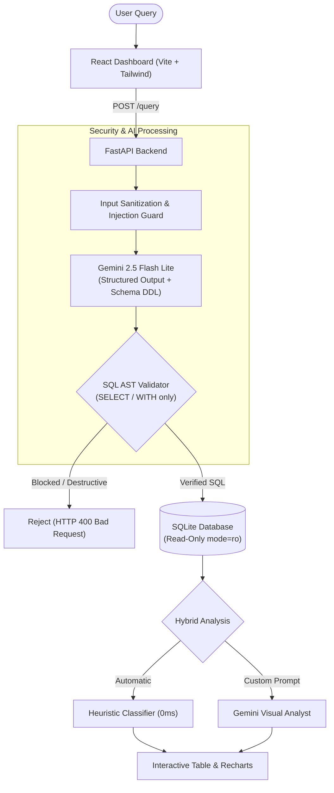
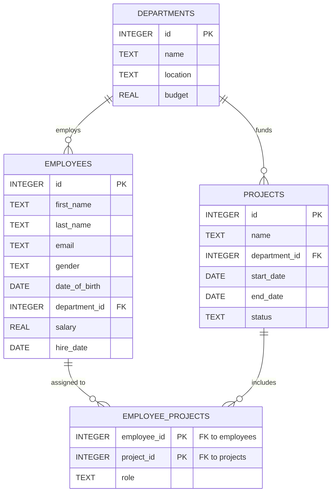

# 🔍 Text-to-SQL Query Generator

[](https://www.python.org/)
[](https://fastapi.tiangolo.com/)
[](https://react.dev/)
[](https://www.typescriptlang.org/)
[](https://ai.google.dev/)
[](https://www.docker.com/)
[](https://tailwindcss.com/)
[](LICENSE)

An enterprise-grade, secure, and analytics-driven natural language to SQL platform. Convert plain English or Turkish questions into verified, read-only SQL queries and visualize data insights automatically with zero added latency.

Powered by **Google Gemini 2.5 Flash Lite** with deterministic structured outputs, a multi-layered **Security Layer**, dynamic schema discovery, and an interactive **React + Vite** dashboard with **Recharts**.

---

## 📑 Table of Contents

- [Overview](#overview)
- [Key Features](#key-features)
- [System Architecture](#system-architecture)
- [Demo Database Schema](#demo-database-schema)
- [Tech Stack](#tech-stack)
- [Getting Started](#getting-started)
  - [Prerequisites](#prerequisites)
  - [Environment Configuration](#environment-configuration)
  - [Option 1: Run with Docker Compose (Recommended)](#option-1-run-with-docker-compose-recommended)
  - [Option 2: Run Locally (Development)](#option-2-run-locally-development)
- [Example Queries](#example-queries-to-try)
- [API Reference](#api-reference)
- [Testing](#testing)
- [Project Structure](#project-structure)
- [Security Model](#security-model)
- [License](#license)

---

## 🌟 Overview

**Text-to-SQL Query Generator** is a full-stack web application that translates natural language questions into safe, optimized SQL queries and visualizes the results instantly.

Instead of writing complex SQL manually, users can simply ask questions in plain English or Turkish (e.g., *"What is the average salary by department?"*). The system safely generates and validates the SQL, executes it against a read-only database, and presents both the raw data and interactive charts.

### Key Highlights
- **Safety First**: Every query is strictly validated via Abstract Syntax Tree (AST) analysis. Destructive operations (`DROP`, `DELETE`, `UPDATE`) are blocked, and database connections are physically read-only (`mode=ro`).
- **Dynamic Schema Discovery**: Automatically adapts to any SQLite database without manual configuration or static ORM models.
- **Instant Visualizations**: Automatically recommends the best chart type (Bar, Line, Pie, Area, or Stat cards) for the data with zero added latency.
- **Modern Dashboard**: Features query history, dynamic schema explorer, dark/light mode, and one-click data exports (CSV, JSON, and PNG).

---

## ✨ Key Features

### 🛡️ Multi-Layered Security Pipeline
- **Input Sanitization**: Rejects input exceeding 1,000 characters and filters harmful control characters.
- **Prompt Injection Defense**: Regex signature matching detects override attempts, role-play escapes, and data exfiltration patterns.
- **AST SQL Whitelisting**: Parses Generated SQL with `sqlparse`; strictly permits only `SELECT` and `WITH` statements.
- **Blocked Keyword Guard**: Blocks destructive DDL/DML keywords (`DROP`, `DELETE`, `TRUNCATE`, `ALTER`, `CREATE`, `INSERT`, `UPDATE`, `PRAGMA`, `ATTACH`, etc.).
- **Multi-Statement Check**: Traps and rejects chained queries separated by semicolons.
- **Row Limit Safeguard**: Transparently appends `LIMIT 1000` if the generated query lacks an explicit limit.
- **Physical Read-Only Engine**: Enforces SQLite URI `?mode=ro&uri=true`.
- **Global Rate Limiting**: Throttles traffic at 30 requests per minute via `SlowAPI`.

### ⚡ Deterministic LLM Integration
- Utilizes **Google Gemini 2.5 Flash Lite** via the official `google-genai` SDK.
- **Structured Output (JSON Schema)**: Ensures deterministic `{ "sql": "...", "explanation": "..." }` payloads without brittle regex scraping.
- **Bilingual & Linguistic Mirroring**: Explanations and insights match the user's natural query language (English, Turkish, etc.).
- **Singleton Client**: Avoids per-request re-initialization latency.

### 🔄 Dynamic Schema Discovery
- Automatic runtime inspection of `sqlite_master` and table PRAGMAs.
- Injects exact `CREATE TABLE` DDL directly into the model context.
- Dedicated `/refresh-schema` endpoint to pick up live database modifications without server restarts.
- Interactive **Schema Explorer** UI with table search, column types, primary/foreign key badges, and row counts.

### 📊 Hybrid Analysis Engine & Visualizations
- **Heuristic Classifier (Zero Latency & Cost)**: Detects column data types and cardinality to immediately configure Bar, Line, Pie, Area, or Stat cards.
- **LLM-Guided Custom Analysis**: Enter natural language visualization instructions (e.g., *"Show budget vs actual spend by department as a horizontal bar chart"*).
- **Automated Insights**: Generates a factual 1–2 sentence analytical summary highlighting peaks, minimums, or key metrics.
- **Export Capabilities**:
  - Export query results to **CSV** or **JSON** (browser-native Blob downloads).
  - Export rendered Recharts visualizations directly to **PNG**.

### 💻 Modern Frontend Experience
- Built with **React 18**, **TypeScript**, **Vite**, and **Tailwind CSS**.
- **TanStack React Query v5**: Manages asynchronous caching, optimistic state updates, and loading lifecycles.
- **Query History**: Automatically preserves the last 50 queries in `localStorage` with one-click re-execution.
- **Segmented Error UX**: High-context inline banners for validation and query issues; non-intrusive Sonner toasts for network or rate-limit warnings.
- **Collapsible SQL Preview**: Syntax-highlighted view with one-click clipboard copy.
- **Dark / Light Mode**: Persistent theme toggle across all components.

---

## 🏗️ System Architecture



---

## 🗄️ Demo Database Schema

The project includes a curated relational SQLite database (`api/sql_app.db`) containing realistic corporate data across 4 interconnected tables:



---

## 🛠️ Tech Stack

| Domain | Technology | Purpose |
|---|---|---|
| **Backend** | FastAPI, Python 3.11+ | High-performance asynchronous REST API |
| **LLM Provider** | Google Gemini 2.5 Flash Lite (`google-genai`) | Structured output text-to-SQL & data analysis |
| **SQL Engine** | SQLAlchemy 2.0, SQLite3 | Read-only connection pooling and raw SQL execution |
| **SQL Parsing** | `sqlparse` | Abstract Syntax Tree inspection and statement whitelisting |
| **Rate Limiter** | `SlowAPI` | Global IP-based request throttling (30 req/min) |
| **Frontend** | React 18, TypeScript, Vite | Client UI with strict static typing |
| **Styling** | Tailwind CSS, Lucide Icons | Responsive modern layout and design system |
| **State & Cache** | TanStack React Query v5 | Server state management and mutation lifecycle |
| **Visualizations**| Recharts, `html-to-image` | Interactive chart components and PNG export |
| **Notifications** | Sonner | Stacked toast notifications |
| **Testing** | Pytest, Pytest-Asyncio, Vitest | Comprehensive backend and frontend unit test suites |
| **Deployment** | Docker, Docker Compose, Nginx | Multi-stage containerized production deployment |

---

## 🚀 Getting Started

### Prerequisites

- **Python**: 3.11 or higher
- **Node.js**: 18.x or 20.x and `npm`
- **Docker**: (Optional, for containerized run) Docker Desktop or Docker Engine + Docker Compose
- **Google Gemini API Key**: Get a free API key at [Google AI Studio](https://aistudio.google.com/)

---

### Environment Configuration

1. Clone the repository:
   ```bash
   git clone https://github.com/username/Text-to-SQL-Query-Generator.git
   cd Text-to-SQL-Query-Generator
   ```

2. Copy the sample environment file and add your Google Gemini API Key:
   ```bash
   cp .env.example .env
   ```

3. Open `.env` and set your key:
   ```env
   GOOGLE_API_KEY=your_actual_gemini_api_key_here
   MODEL_NAME=gemini-2.5-flash-lite
   DATABASE_URL=sqlite:///./sql_app.db
   VITE_API_URL=http://localhost:8000
   ```

---

### Option 1: Run with Docker Compose (Recommended)

Run the full stack (backend + frontend) with a single command:

```bash
docker compose up --build
```

- **Frontend**: Accessible at [http://localhost:3000](http://localhost:3000)
- **Backend API Docs**: Accessible at [http://localhost:8000/docs](http://localhost:8000/docs)
- **Health Check**: Accessible at [http://localhost:8000/health](http://localhost:8000/health)

To stop the containers:
```bash
docker compose down
```

---

### Option 2: Run Locally (Development)

#### 1. Start the Backend API

```bash
# Optional: create and activate virtual environment
python -m venv .venv
# On Windows:
.venv\Scripts\activate
# On Linux/macOS:
source .venv/bin/activate

# Install dependencies
pip install -r api/requirements.txt

# (Optional) Re-seed the demo SQLite database if needed
python api/seed_demo_data.py

# Launch FastAPI server with hot reloading
uvicorn api.main:app --reload --port 8000
```
Backend will be available at `http://localhost:8000` (Swagger UI at `/docs`).

#### 2. Start the Frontend Development Server

Open a second terminal:

```bash
# Install frontend dependencies
npm install

# Start Vite development server
npm run dev
```
Frontend will be available at `http://localhost:5173`.

---

## 💡 Example Queries to Try

Test the platform with diverse analytical questions (English or Turkish):

| Category | Example Question |
|---|---|
| **Department Aggregations** | *"What is the average salary and total employee count in each department?"* |
| **Multi-Table JOINs** | *"List all employees assigned to the 'AI Analytics Platform' project along with their project roles."* |
| **Budget Analysis** | *"Show departments ordered by budget descending and compare with their employee count."* |
| **Date & Tenure Filters** | *"Which employees were hired after 2021 with a salary exceeding 90,000?"* |
| **Project Status Trends** | *"Count the number of projects by their current status."* |
| **Turkish Language Support** | *"Mühendislik departmanındaki çalışanların maaş ortalaması nedir?"* |
| **Security Validation Test** | *"Drop the employees table"* *(Expected: Blocked by Security Layer)* |

---

## 📡 API Reference

### Core Endpoints

| Method | Endpoint | Description | Request Body |
|---|---|---|---|
| `POST` | `/query` | Converts natural language question to SQL, verifies, and executes. | `{ "question": "string" }` |
| `POST` | `/analyze` | Generates chart configuration and analytical insights. | `{ "columns": [...], "rows": [...], "user_request": "string?", "use_llm": bool }` |
| `GET` | `/schema` | Discovers full schema metadata, columns, and foreign keys. | *None* |
| `POST` | `/refresh-schema` | Forces cache invalidation and rediscovery of database schema. | *None* |
| `GET` | `/health` | Service health status, active model, and database URL. | *None* |

Full interactive OpenAPI / Swagger documentation is available at `http://localhost:8000/docs`.

---

## 🧪 Testing

The repository maintains comprehensive test suites for both backend and frontend layers:

### Backend Tests (Pytest)
Includes 89 automated tests verifying input sanitization, prompt injection defenses, AST whitelisting, database execution, schema discovery, and heuristic analysis:

```bash
pytest
```

### Frontend Tests (Vitest)
Unit tests verifying component rendering, query history storage, API client behavior, and export utilities:

```bash
npm test
```

### Type Checking & Linting
```bash
# Frontend TypeScript check & build
npm run build

# Frontend ESLint
npm run lint
```

---

## 📁 Project Structure

```
Text-to-SQL-Query-Generator/
├── api/                           # Backend FastAPI service
│   ├── tests/                     # Pytest suite (89 tests)
│   ├── analysis.py                # Heuristic & LLM visualization engine
│   ├── config.py                  # Pydantic Settings & environment loader
│   ├── database.py                # Read-only SQLAlchemy engine & schema discovery
│   ├── gemini_service.py          # Gemini 2.5 Flash Lite client (structured output)
│   ├── main.py                    # FastAPI routes, rate limiter, and error handlers
│   ├── requirements.txt           # Python dependencies
│   ├── schemas.py                 # Pydantic DTO models
│   ├── security.py                # AST validator, keyword guard & injection detector
│   ├── seed_demo_data.py          # Demo database seeder script
│   ├── sql_app.db                 # Pre-seeded SQLite demo database (32 KB)
│   └── Dockerfile                 # Backend container definition
├── src/                           # Frontend React application
│   ├── components/                # React UI components
│   │   ├── ChartView.tsx          # Recharts visualizations & PNG export
│   │   ├── ExampleQueries.tsx     # Clickable sample query chips
│   │   ├── InlineError.tsx        # High-visibility security/syntax error card
│   │   ├── LoadingSkeleton.tsx    # Responsive skeleton states
│   │   ├── Navbar.tsx             # Header with theme toggle & schema refresh
│   │   ├── QueryHistory.tsx       # LocalStorage query history drawer
│   │   ├── QueryInput.tsx         # Natural language prompt editor
│   │   ├── ResultTable.tsx        # Paginated data table with CSV/JSON exports
│   │   ├── SchemaExplorer.tsx     # Interactive database catalog browser
│   │   └── SqlPreview.tsx         # Collapsible Generated SQL display
│   ├── data/                      # Example query definitions
│   ├── services/                  # API client methods & error normalization
│   ├── utils/                     # Export helpers (CSV/JSON) & storage utilities
│   ├── App.tsx                    # Root layout & TanStack Query orchestration
│   ├── main.tsx                   # Application bootstrap
│   └── index.css                  # Tailwind styles
├── docs/                          # Architecture Decision Records (ADRs) & agents guide
│   └── adr/
│       ├── 0001-gemini-structured-output.md
│       └── 0002-dynamic-schema-without-orm.md
├── docker-compose.yml             # Orchestration for frontend & backend services
├── Dockerfile                     # Multi-stage frontend Dockerfile (Node + Nginx)
├── nginx.conf                     # Production Nginx reverse-proxy configuration
├── package.json                   # Frontend npm dependencies
├── pytest.ini                     # Pytest runner configuration
├── tailwind.config.js             # Tailwind CSS configuration
├── tsconfig.json                  # TypeScript compiler settings
├── vite.config.ts                 # Vite build settings
└── LICENSE                        # MIT License
```

---

## 🔒 Security Model

1. **Zero Write Permissions**: The SQLite connection string specifies `mode=ro`. Write operations are impossible at the filesystem driver level.
2. **Grammar-Level Inspection**: Queries are tokenized via `sqlparse`. Any syntax tree beginning with non-`SELECT` or non-`WITH` tokens is rejected before touching the database.
3. **Keyword Blacklist**: Comprehensive blocking of SQLite DDL/DML functions (`DROP`, `DELETE`, `ALTER`, `ATTACH`, `DETACH`, `PRAGMA`).
4. **Injection Guard**: Detects jailbreak markers (e.g., `ignore previous instructions`, `system prompt override`, `act as DAN`).
5. **Multi-Statement Blocker**: Prevents statement chaining via semicolons.
6. **Throttling**: Protects LLM quotas and infrastructure with rate limits (30 req/min).

---

## 📄 License

This project is licensed under the MIT License - see the [LICENSE](LICENSE) file for details.